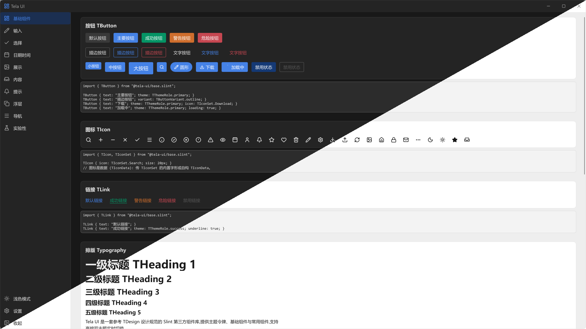

English | [简体中文](README_zh.md)

# Tela UI

An unofficial third-party [Slint](https://slint.dev) component library in the style of TDesign



## Quick Start

Register the library path in `build.rs`, then import components with the `@tela-ui/` prefix. `tela_ui::import_paths()` resolves the absolute path of the `.slint` files shipped inside the `tela-ui` crate, so it works both for a git clone and for a crates.io install:

```rust
fn main() {
    let config = slint_build::CompilerConfiguration::new()
        .with_library_paths(tela_ui::import_paths())
        .with_style("fluent".into());
    slint_build::compile_with_config("ui/MainWindow.slint", config).unwrap();
}
```

```slint
import { TTheme, TThemeRole } from "@tela-ui/theme.slint";
// Category aggregates — you can also import directly from
// "@tela-ui/base/button.slint" and similar files
import { TButton, TButtonVariant, TIcon } from "@tela-ui/base.slint";
import { TInput } from "@tela-ui/input.slint";
import { TSelect } from "@tela-ui/select.slint";
import { TCard, TTag } from "@tela-ui/display.slint";
import { TSkeleton } from "@tela-ui/experimental.slint";

export component MainWindow inherits Window {
    background: TTheme.bg-color-page;

    TButton {
        theme: TThemeRole.primary;
        variant: TButtonVariant.outline;
        text: "Primary Button";
    }
}
```

Run the gallery (component showcase app):

```sh
cargo run                     # follow the system light/dark scheme
TELA_THEME=dark cargo run     # POSIX: force dark mode (only light / dark accepted; any other value exits with an error at startup)
$env:TELA_THEME="dark"; cargo run   # PowerShell equivalent
```

## Theming

All tokens live on the `TTheme` global (`theme.slint`). The active configuration is a `TAppThemeConfig` struct; `light` / `dark` are two `in-out` presets.

```slint
// Reading
Rectangle { background: TTheme.bg-color-container; }
// Overriding a single token
TTheme.dark.bg-page = #101010;
```

To replace a theme wholesale, use `TTheme.dark = { ... }`; every omitted field must be filled in. Derive from `TLightColors` / `TDarkColors` in `@tela-ui/colors.slint` to keep the color ramps intact; the full field list is in `structs/theme.slint`.

```rust
// From the Rust side: the std-widgets `Palette` global carries the mode
// preference. Export it from your own .slint (`export { Palette } from
// "std-widgets.slint";`) and pull it into scope with `slint::include_modules!()`.
use slint::language::ColorScheme;
Palette::get(&ui).set_color_scheme(ColorScheme::Dark);
```

The mode preference is simply the standard library `Palette.color-scheme` (in-out, std-widgets): `light`/`dark` force a mode, `unknown` follows the OS. Read and write it directly and the tela tokens switch together with std-widgets components (AboutSlint / ScrollView, etc.); the library's own components reskin via each component's `states`. Light/dark toggles should bind to `TTheme.is-dark` (not `Palette.color-scheme`) so they reflect the resolved mode (tela tokens default to dark under `unknown`).

```slint
TSwitch {
    checked: TTheme.is-dark;      // true when Palette.color-scheme is dark or unknown
    changed(c) => { Palette.color-scheme = c ? ColorScheme.dark : ColorScheme.light; }
}
```

Components are exported as aggregates by interaction type: `base` / `input` / `select` / `date-time` / `display` / `content` / `notice` / `overlay` / `navigation` / `experimental`; additionally there are service overlays (dialog / loading / message / notification / image viewer / command palette / action sheet / tooltip / guide) and three globals for theme, icons, and the overlay stack. `@tela-ui/common.slint` is kept as a full compatibility export. Full parameter documentation and each component's known limitations: [docs/components.md](docs/components.md); component statistics: [docs/architecture.md](docs/architecture.md).

## Acknowledgements & Notes

- Icon geometry data comes from [Lucide](https://lucide.dev) (ISC license), packaged in the data-driven structure of [lucide-slint](https://github.com/cnlancehu/lucide-slint) (MIT OR Apache-2.0).
- Design tokens follow the [TDesign specification](https://tdesign.tencent.com).

## License

Copyright 2026 DragonheartLX, licensed under [Apache-2.0](LICENSE).

Note: this license only covers the tela-ui source code. Apps built with Slint are additionally subject to Slint's own licensing (GPL-3.0 or the royalty-free Slint license).
