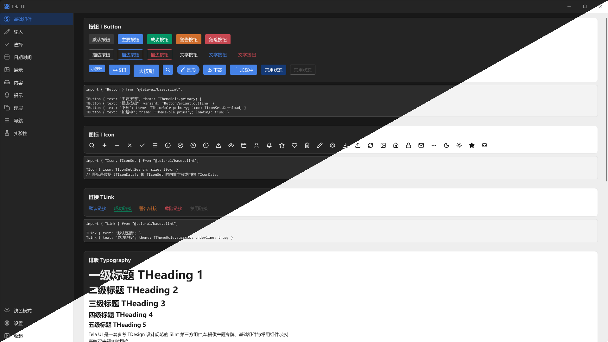

# Tela UI

TDesign 风格的 [Slint](https://slint.dev) 第三方组件库



## 快速开始

在 `build.rs` 中注册组件库路径, 之后即可用 `@tela-ui/` 前缀导入组件:

```rust
use std::{collections::HashMap, path::PathBuf};

fn main() {
    let library_paths = HashMap::from([(
        "tela-ui".to_string(),
        PathBuf::from("path/to/tela-ui"), // 本项目的 tela-ui/ 文件夹
    )]);
    let config = slint_build::CompilerConfiguration::new()
        .with_library_paths(library_paths);
    slint_build::compile_with_config("ui/MainWindow.slint", config).unwrap();
}
```

```slint
import { TTheme, TThemeRole } from "@tela-ui/theme.slint";
// 分类聚合导出 — 也可以直接从 "@tela-ui/base/button.slint" 等文件导入
import { TButton, TButtonVariant, TIcon } from "@tela-ui/base.slint";
import { TInput } from "@tela-ui/input.slint";
import { TSelect } from "@tela-ui/select.slint";
import { TCard, TTag } from "@tela-ui/display.slint";
import { TSkeleton } from "@tela-ui/experimental.slint";

export component MainWindow inherits Window {
    background: TTheme.bg-color-page;

    TButton {
        theme: TThemeRole.primary;
        variant: TButtonVariant.outline;
        text: "主要按钮";
    }
}
```

运行 gallery (组件陈列应用):

```sh
cargo run                     # 跟随系统深浅色
TELA_THEME=dark cargo run     # POSIX: 强制暗色 (只认 light / dark, 其它值启动即报错退出)
$env:TELA_THEME="dark"; cargo run   # PowerShell 写法
```

## 主题

所有令牌都在 `TTheme` 全局 (`theme.slint`) 上。当前生效的配置是一个 `TAppThemeConfig` 结构体; `light` / `dark` 是两个 `in-out` 预设。

```slint
// 读取
Rectangle { background: TTheme.bg-color-container; }
// 覆盖单个令牌
TTheme.dark.bg-page = #101010;
```

整体替换用 `TTheme.dark = { ... }`; 省略字段必须补齐, 请基于 `@tela-ui/colors.slint` 的 `TLightColors` / `TDarkColors` 派生以保留色阶, 完整字段见 `structs/theme.slint`。

```rust
// 从 Rust 侧操作 (Palette/TTheme 由 ui/MainWindow.slint 再导出;
// ColorScheme 走生成代码同款 re-export 路径)
use tela_lib::Palette;
use slint::private_unstable_api::re_exports::ColorScheme;
Palette::get(&ui).set_color_scheme(ColorScheme::Dark);
```

模式偏好就是标准库 `Palette.color-scheme` (in-out, std-widgets): `light`/`dark` 强制, `unknown` 跟随 OS。直接读写它, tela 令牌与标准库组件 (AboutSlint / ScrollView 等) 一起切换; 组件通过各自的 `states` 自动换肤。亮暗开关应绑定 `TTheme.is-dark` (而非 `Palette.color-scheme`), 以反映解析后的模式 (`unknown` 下 tela 令牌默认暗色)。

```slint
TSwitch {
    checked: TTheme.is-dark;      // Palette.color-scheme 为 dark 或 unknown 时为 true
    changed(c) => { Palette.color-scheme = c ? ColorScheme.dark : ColorScheme.light; }
}
```

组件按交互类型聚合导出: `base` / `input` / `select` / `date-time` / `display` / `content` / `notice` / `overlay` / `navigation` / `experimental`; 另有服务型浮层 (对话框 / 加载 / 消息 / 通知 / 图片预览 / 命令面板 / 动作面板 / 提示 / 引导) 与主题、图标、浮层栈三个全局对象。`@tela-ui/common.slint` 保留为全量兼容出口。完整参数说明与各组件已知限制见 [docs/components.md](docs/components.md); 组件统计见 [docs/architecture.md](docs/architecture.md)。

## 致谢与说明

- 图标几何数据来自 [Lucide](https://lucide.dev) (ISC 许可), 按 [lucide-slint](https://github.com/cnlancehu/lucide-slint) (MIT OR Apache-2.0)的数据化结构打包。
- 设计令牌遵循 [TDesign 规范](https://tdesign.tencent.com)。

## 许可证

版权所有 2026 DragonheartLX, 采用 [Apache-2.0](LICENSE) 许可证。

注意: 本许可证仅覆盖 tela-ui 源码。基于 Slint 构建的应用还额外受 Slint 自身许可 (GPL-3.0 或免版税的 Slint 许可) 约束。
